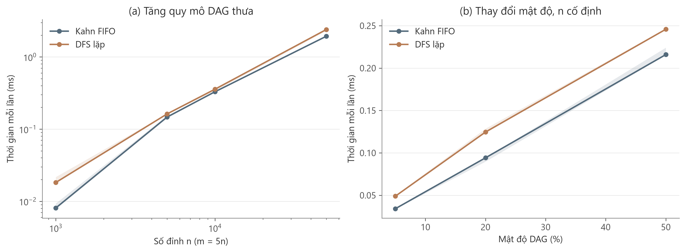
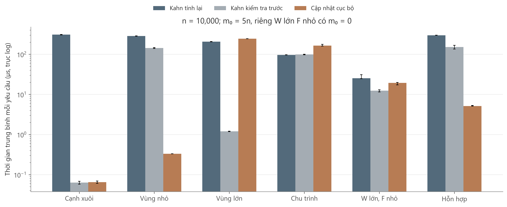

# Topological sorting benchmark

[](https://github.com/Solitudeshu/topological-sorting/actions/workflows/verify.yml)

Benchmark C++17 cho sắp xếp tô-pô trên đồ thị cố định và duy trì thứ tự khi thêm cạnh. Repository chứa các thuật toán, bộ sinh DAG, kiểm chứng độc lập, đầu vào tái lập và kết quả đo kèm biểu đồ. Python điều phối phép đo, tổng hợp CSV và trực quan hóa.

## Phạm vi benchmark

| Benchmark | Phương pháp | Nội dung đánh giá |
|---|---|---|
| A — Đồ thị cố định | Kahn FIFO, DFS lặp | Ảnh hưởng của quy mô, mật độ và cấu trúc DAG |
| B — Thêm cạnh | Kahn tính lại, Kahn kiểm tra trước, cập nhật cục bộ | Chi phí nhận hoặc từ chối cạnh và duy trì thứ tự hợp lệ |

Benchmark B có sáu tình huống: cạnh xuôi, vùng nhỏ, vùng lớn, tạo chu trình, cửa sổ lớn nhưng tập tìm kiếm nhỏ và chuỗi hỗn hợp. Dữ liệu là các đồ thị tổng hợp có kiểm soát, chưa đại diện cho một hệ thống vận hành cụ thể.

## Kết quả

### Benchmark A

Thời gian trên DAG ngẫu nhiên thưa, với `m = 5n`:

| Số đỉnh n | Số cạnh m | Kahn FIFO (ms) | DFS lặp (ms) |
|---|---|---|---|
| 1.000 | 5.000 | 0,0081 | 0,0182 |
| 5.000 | 25.000 | 0,1469 | 0,1623 |
| 10.000 | 50.000 | 0,3293 | 0,3575 |
| 50.000 | 250.000 | 1,9329 | 2,3955 |



Thời gian tăng theo số đỉnh và số cạnh. Kahn có trung vị thấp hơn trên các cấu hình minh họa; chênh lệch phụ thuộc bản cài đặt và dữ liệu dù cả hai cùng có độ phức tạp `O(n + m)`.

### Benchmark B

Thời gian mỗi yêu cầu tại `n = 10.000`, `m₀ = 50.000`, `q = 200`; riêng W lớn, F nhỏ bắt đầu từ đồ thị rỗng:

| Tình huống | Kahn tính lại (µs) | Kahn kiểm tra trước (µs) | Cục bộ (µs) |
|---|---|---|---|
| Cạnh xuôi | 308,252 | 0,063 | 0,065 |
| Vùng nhỏ | 284,603 | 143,804 | 0,332 |
| Vùng lớn | 205,782 | 1,201 | 244,153 |
| Tạo chu trình | 96,337 | 98,347 | 164,664 |
| W lớn, F nhỏ | 25,350 | 12,371 | 19,324 |
| Hỗn hợp | 297,537 | 151,029 | 5,119 |



Cập nhật cục bộ có lợi khi vùng tác động nhỏ, nhưng có thể chậm hơn tính lại khi tìm kiếm hoặc sắp lại nhiều đỉnh. Với cạnh xuôi, cả Kahn kiểm tra trước và cục bộ đều tránh được tính lại. Trong tình huống vùng lớn, Kahn kiểm tra trước chỉ tính lại một lần trên chuỗi 200 yêu cầu: thứ tự mới khiến các yêu cầu sau trở thành cạnh xuôi. Vì mỗi phương pháp có thể duy trì một thứ tự khác nhau, cùng chuỗi yêu cầu không đồng nghĩa cùng lượng công việc.

W là cửa sổ sắp lại, F là tập đỉnh tìm được của thuật toán cục bộ. Trường hợp W lớn, F nhỏ chỉ tìm một đỉnh nhưng ghi lại trung bình 9.801 vị trí. Biểu đồ [số thao tác](benchmark/results/full/figures/operation_counts.png) và [quy mô, mật độ](benchmark/results/full/figures/scaling_density.png) bổ sung các góc nhìn này. Bộ sinh chu trình đặt cạnh chuỗi trước các cạnh bổ sung; thứ tự duyệt đó ảnh hưởng đến thời điểm DFS phát hiện chu trình.

### Môi trường và dữ liệu đo

| Thành phần | Cấu hình |
|---|---|
| CPU | Intel Core i5-13500H |
| RAM | 15,63 GiB, khoảng 16 GB |
| Hệ điều hành | Windows 11 25H2, build 26200 |
| Trình biên dịch | GCC 14.1.0, C++17, `-O3 -DNDEBUG` |
| Thực thi | Đơn luồng |
| Lặp đo | 5 seed × 10 lượt đo; 3 lượt khởi động |
| Dữ liệu | 145 bộ tĩnh, 135 bộ động; 27.000 yêu cầu cập nhật |

Các bảng lấy trung vị trong từng seed, sau đó lấy trung vị giữa năm seed. Vùng tô và thanh sai số là khoảng tứ phân vị giữa seed. Thời gian cập nhật là thời gian toàn chuỗi chia số yêu cầu, không phải phân vị độ trễ từng yêu cầu. Hệ số tăng tốc trong CSV được tổng hợp từ tỷ số theo cặp cùng seed, nên có thể khác tỷ số của hai trung vị trong bảng.

Metadata gốc nằm trong [environment.json](benchmark/results/full/environment.json). Chuỗi `platform` của Python ghi `Windows-10-10.0.26200-SP0`; build 26200 tương ứng Windows 11 25H2. Đây là tên nhận diện từ công cụ thu thập, không phải tên thương mại của hệ điều hành.

Bản C++ đã dùng cho phép đo được lưu nguyên byte dưới dạng gzip trong [source/](benchmark/results/full/source/), đối chiếu bằng SHA-256 trong metadata. Mã nguồn hiện tại đã được định dạng lại; audit kiểm tra bản nguồn lưu trữ và cho biết riêng mã hiện tại có trùng byte với bản đã đo hay không. Số liệu công bố được giữ nguyên.

| Dữ liệu công bố | Vị trí |
|---|---|
| Kết quả tổng hợp và IQR | [summary.csv](benchmark/results/full/summary/summary.csv) |
| Hệ số tăng tốc theo cặp | [speedups.csv](benchmark/results/full/summary/speedups.csv) |
| Thống kê từng seed | [per_seed.csv](benchmark/results/full/summary/per_seed.csv) |
| Từng lượt đo và cập nhật | [raw/](benchmark/results/full/raw/) |
| Đầu vào và SHA-256 | [data/full/](benchmark/data/full/), [manifest.json](benchmark/results/full/manifest.json) |
| Kiểm chứng dữ liệu đo | [validation_summary.json](benchmark/results/full/summary/validation_summary.json), [audit.json](benchmark/results/full/summary/audit.json) |

## Thuật toán

Mã C++ nằm trong [topo.hpp](benchmark/include/topo.hpp), dùng danh sách kề và mã đỉnh từ 0 đến n − 1.

| Tên trong kết quả | Cách xử lý |
|---|---|
| `kahn_fifo` | Sắp xếp tĩnh bằng bậc vào và hàng đợi FIFO |
| `dfs_iterative` | Sắp xếp tĩnh bằng DFS lặp, ba trạng thái và đảo hậu duyệt |
| `kahn_recompute` | Thử thêm cạnh rồi chạy Kahn; hoàn tác nếu tạo chu trình |
| `kahn_guarded` | Chèn ngay nếu cạnh xuôi; nếu vi phạm thứ tự thì tính lại bằng Kahn |
| `incremental_rpo` | Tìm kiếm tiến có chặn, phát hiện chu trình và sắp lại trong cửa sổ |

Với cạnh ngược `u → v`, thuật toán cục bộ tìm từ v trong cửa sổ W từ `pos[v]` đến `pos[u]`. Nếu gặp u, cạnh bị từ chối. Nếu không, gọi F là tập đỉnh tìm được, R là phần còn lại của W; thuật toán xếp R theo thứ tự cũ rồi F theo đảo hậu duyệt DFS. Không có cạnh từ F sang R, vì đích của cạnh đó cũng phải thuộc tập tìm được. Các cạnh nội bộ R, nội bộ F và qua biên cửa sổ vẫn hợp lệ; u thuộc R và v thuộc F nên cạnh mới cũng được thỏa mãn.

Chi phí cạnh ngược hợp lệ là `O(|Vₛ| + |Eₛ| + |W|)`; phát hiện chu trình trước khi sắp lại là `O(|Vₛ| + |Eₛ|)`. Eₛ tính mọi phần tử danh sách kề được kiểm tra, kể cả cạnh có đích ngoài cửa sổ. Trường hợp xấu nhất là `O(n + m)` mỗi yêu cầu, bộ nhớ phụ `O(n)`. Đây là biến thể tìm kiếm tiến đơn giản, không phải bản cài đặt PK hay BFGT.

API mặc định kiểm tra chỉ số đỉnh, cạnh trùng và cạnh tự nối. Khi từ chối chu trình, tập cạnh và thứ tự được giữ nguyên. Dữ liệu đo bảo đảm cạnh mới không trùng hoặc tự nối trước khi gọi nhánh `novel=true`, nên không tính chi phí quét kiểm tra trùng. Với hợp đồng đó, cạnh xuôi có chi phí `O(1)` khấu hao; API mặc định có thêm chi phí `O(outdegree(u))` để kiểm tra trùng. Mảng dấu thăm dùng bộ đếm thế hệ để tránh xóa toàn bộ mảng sau mỗi yêu cầu.

## Phương pháp đo và kiểm chứng

Đồng hồ C++ là `std::chrono::steady_clock`. Lượt có bộ đếm và lượt đo thời gian chạy riêng; bộ đếm bị loại khỏi bản đo bằng `if constexpr`.

- **Topo tĩnh:** đầu vào là danh sách kề có sẵn; tính cả cấu trúc phụ và kết quả. Batch thích nghi nhắm khoảng 3 ms, tối đa 1.000 lần; lấy thời gian batch chia số lần chạy. Có checksum `O(1)` trong mỗi lần; kiểm tra đầy đủ nằm ngoài đồng hồ.
- **Cập nhật động:** tính chèn cạnh, tìm kiếm, cấp phát, sắp lại và hoàn tác trên cả chuỗi. Chi phí tạo trạng thái mới được ghi riêng trong `setup_ns`. Mỗi lượt bắt đầu từ cùng trạng thái ban đầu; thứ tự chạy phương pháp được xáo trộn có seed.
- **Ngoài phạm vi đo:** sinh dữ liệu, đọc tệp, kiểm chứng, ghi CSV và vẽ hình.

Bộ nhớ là payload theo capacity của vector trong lượt có bộ đếm, tách đồ thị khỏi cấu trúc phụ. Giá trị này không bao gồm metadata bộ cấp phát, runtime và các bản sao của harness, nên không phải RAM đỉnh của tiến trình. `vertices` đếm đỉnh xử lý hoặc tìm kiếm; `edge_checks` đếm phần tử danh sách kề được xét; `window_len` là độ dài cửa sổ; `order_writes` và `pos_writes` đếm vị trí được ghi, khác với số đỉnh thực sự đổi vị trí.

Tính đúng đắn được kiểm tra bằng hoán vị đầy đủ, điều kiện trước–sau trên mọi cạnh và oracle tìm đường độc lập cho cập nhật. Bộ kiểm thử bao gồm toàn bộ 4.096 đồ thị không tự nối trên bốn đỉnh, 543 DAG, chuỗi dài 100.000 đỉnh, cạnh trùng, tự nối, chỉ số sai và 100 seed ngẫu nhiên. NetworkX đối chiếu thêm 31 chuỗi. Tất cả 280 bộ dữ liệu công bố đều vượt qua kiểm chứng; [biên bản C++](benchmark/tests/validation_unit.json) và [biên bản NetworkX](benchmark/tests/validation_networkx.json) được lưu cùng mã nguồn.

## Cấu trúc repository

```text
benchmark/
├── include/topo.hpp       # thuật toán và bộ đếm
├── src/runner.cpp         # kiểm chứng, đo thời gian, xuất CSV
├── tests/                 # kiểm thử C++ và kết quả đối chiếu
├── configs/               # quick và full
├── scripts/               # build, sinh dữ liệu, đo, tổng hợp, vẽ, audit, replay
├── data/                  # fixture và đầu vào full nén gzip
└── results/full/          # metadata, raw, summary, figures
.github/workflows/verify.yml
```

## Build và chạy

Yêu cầu: Python 3.11, GCC hoặc Clang hỗ trợ C++17 và các thư viện trong [requirements.txt](benchmark/requirements.txt). Build script tự chọn `g++` hoặc `clang++` trên PATH.

Trên Windows PowerShell, từ thư mục gốc repository:

```powershell
python -m venv .venv
.venv/Scripts/python.exe -m pip install -r benchmark/requirements.txt
.venv/Scripts/python.exe benchmark/scripts/build.py
benchmark/build/topo_tests.exe
.venv/Scripts/python.exe benchmark/scripts/verify_networkx.py
.venv/Scripts/python.exe benchmark/scripts/run_benchmarks.py --profile quick --skip-build
.venv/Scripts/python.exe benchmark/scripts/summarize.py --profile quick
.venv/Scripts/python.exe benchmark/scripts/plot_results.py --profile quick
```

Trên Linux/macOS, thay `.venv/Scripts/python.exe` bằng `.venv/bin/python` và bỏ đuôi `.exe` của executable C++. Profile `quick` dùng dữ liệu nhỏ để kiểm tra pipeline; `full` dùng [cấu hình đầy đủ](benchmark/configs/full.json), với nhiều quy mô, mật độ và năm seed.

Ba lệnh đo, tổng hợp và vẽ nhận `--profile full` để chạy đầy đủ. Lệnh đo ghi vào thư mục dữ liệu và kết quả tương ứng; lưu bản kết quả hiện có trước khi chạy lại profile `full`. Để đo lại đầu vào công bố và giữ nguyên kết quả đó, dùng replay:

```powershell
.venv/Scripts/python.exe benchmark/scripts/replay.py --workload dynamic_local_small_n10000_m50000_q200_s11
```

Tên bộ dữ liệu nằm trong manifest; `--workload all` chạy toàn bộ đầu vào lưu trữ. Kết quả mới nằm tại `benchmark/results/replay/`. Kiểm tra SHA-256 đầu vào, nguồn C++ được đo và các điều kiện kết quả bằng:

```powershell
.venv/Scripts/python.exe benchmark/scripts/audit_results.py --profile full
```

Đầu vào `.dag` sau giải nén có dòng đầu `TOPO_WORKLOAD_V1`, tiếp theo `n m q`, một dòng thứ tự ban đầu, m dòng cạnh và q dòng yêu cầu. Chạy trực tiếp executable:

```text
topo_bench --input path/to/input.dag --out path/to/output --repeats 10 --warmups 3
```

`--mode validate` chỉ kiểm chứng; `--mode trace` xuất quyết định và thứ tự sau mỗi yêu cầu vào `trace.jsonl`, hỗ trợ cả cạnh trùng và tự nối.

CMake là lựa chọn build thay thế:

```text
cmake -S benchmark -B benchmark/build -DCMAKE_BUILD_TYPE=Release
cmake --build benchmark/build --config Release
ctest --test-dir benchmark/build -C Release --output-on-failure
```

Với CMake đa cấu hình, executable có thể nằm trong thư mục `Release`; các script Python mặc định dùng vị trí do `build.py` tạo. GitHub Actions kiểm tra định dạng, build, kiểm thử, đối chiếu NetworkX, pipeline `quick` và dữ liệu công bố trên Linux.

## Định dạng mã nguồn

C++ dùng clang-format với thụt lề bốn dấu cách, giới hạn 100 ký tự mỗi dòng và dấu ngoặc cho các khối điều khiển. Python dùng Black với giới hạn 88 ký tự mỗi dòng. Cấu hình được lưu trong `.clang-format` và `pyproject.toml`.

```powershell
.venv/Scripts/python.exe -m pip install -r benchmark/requirements-dev.txt
.venv/Scripts/python.exe -m black benchmark/scripts
.venv/Scripts/clang-format.exe -i benchmark/include/topo.hpp benchmark/src/runner.cpp benchmark/tests/test_topo.cpp
```

Trên Linux/macOS, dùng `.venv/bin/python` và `.venv/bin/clang-format`. Để chỉ kiểm tra, dùng `black --check benchmark/scripts` và `clang-format --dry-run --Werror` với ba file C++ trên.

## Giới hạn và tài liệu tham khảo

Kết quả phản ánh một máy, một cấu hình biên dịch và các bộ sinh đã mô tả. Bộ sinh DAG dựa trên hoán vị ẩn, không lấy mẫu đồng đều trên toàn bộ tập DAG. Benchmark chưa đo đồ thị vận hành thực tế, xóa cạnh, lập lịch giới hạn tài nguyên hoặc so sánh với bản cài đặt PK/BFGT. Số liệu hữu hạn không chứng minh cận tiệm cận và không xác lập một hệ số tăng tốc chung.

- Kahn (1962), [Topological sorting of large networks](https://doi.org/10.1145/368996.369025).
- MIT 6.006, [DFS và topological sorting](https://ocw.mit.edu/courses/6-006-introduction-to-algorithms-fall-2011/resources/mit6_006f11_lec14/).
- Pearce và Kelly (2007), [A Dynamic Topological Sort Algorithm for Directed Acyclic Graphs](https://whileydave.com/publications/PK07_JEA_preprint.pdf), tham khảo baseline và đánh giá thực nghiệm.
- [NetworkX DAG API](https://networkx.org/documentation/stable/reference/algorithms/dag.html), dùng cho đối chiếu độc lập.
- [Google Benchmark User Guide](https://github.com/google/benchmark/blob/main/docs/user_guide.md), tham khảo cách khởi động và lặp đo; harness C++ của repository được cài riêng.
