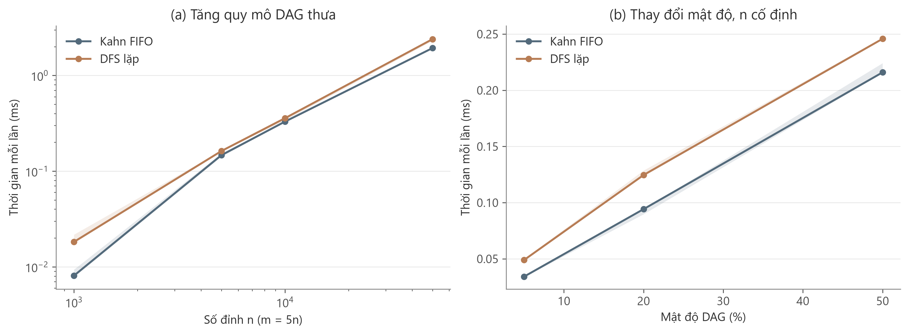
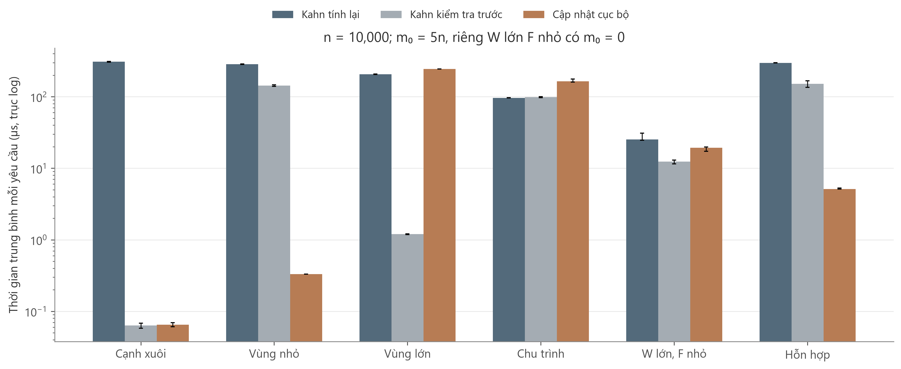
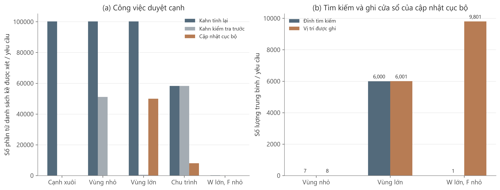
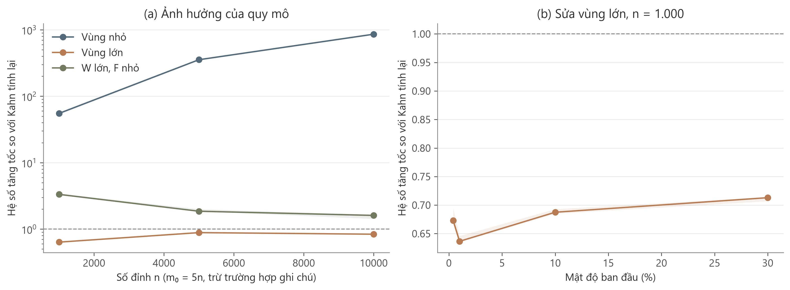

# Phần 7 Benchmark và đánh giá thực nghiệm

## 7.1 Mục tiêu thực nghiệm

Phần thực nghiệm đánh giá chi phí tìm và duy trì thứ tự tô-pô trên các đồ thị phụ thuộc có quy mô, mật độ và dạng cập nhật khác nhau. Hai nhóm thí nghiệm được thực hiện: Benchmark A so sánh Kahn FIFO với DFS lặp trên đồ thị cố định; Benchmark B so sánh tính lại Kahn sau mỗi yêu cầu thêm cạnh với cập nhật thứ tự cục bộ. Một baseline Kahn có kiểm tra thứ tự trước khi tính lại được bổ sung để tách lợi ích của phép kiểm tra vị trí khỏi lợi ích của tìm kiếm và sửa thứ tự cục bộ.

Các giả thuyết cần kiểm tra là: thời gian của topo tĩnh tăng khi kích thước đồ thị tăng; cập nhật cục bộ có lợi khi tránh được phần lớn công việc toàn cục; và lợi thế có thể giảm hoặc đảo chiều khi phải tìm kiếm hoặc sửa một vùng lớn. Các phép đo đồng thời kiểm tra tính đúng đắn, vì thời gian thấp chỉ có ý nghĩa khi thứ tự và quyết định nhận hoặc từ chối cạnh đều hợp lệ.

Kết quả cho thấy cần xét cả vùng tác động, cách biểu diễn trạng thái và thứ tự mà từng phương pháp duy trì. Cập nhật cục bộ không nhanh hơn trong mọi trường hợp, ngay cả khi số cạnh được kiểm tra ít hơn baseline.

## 7.2 Thiết kế thí nghiệm

### 7.2.1 Môi trường và thuật toán

Thí nghiệm chạy ngày 01/11/2026 trên một máy duy nhất, đơn luồng, với cấu hình sau.

| Thành phần | Cấu hình |
|---|---|
| CPU | 13th Gen Intel(R) Core(TM) i5-13500H |
| RAM vật lý | 15,63 GiB |
| Hệ điều hành | Windows-10-10.0.26200-SP0 |
| Compiler | g++.EXE (Rev3, Built by MSYS2 project) 14.1.0; C++17 |
| Cờ biên dịch | -O3 -DNDEBUG -Wall -Wextra -Wpedantic |
| Python và thư viện | Python 3.11.9; numpy 2.4.6; matplotlib 3.11.0; networkx 3.4.2 |
| Nguồn C++ được đo | 8eede3714ecd |
| Lặp và khởi động | 5 seed × 10 lượt đo; 3 lượt khởi động cho mỗi workload và thuật toán |

Mọi thuật toán dùng danh sách kề `vector<vector<int>>` và cùng kiểu mã đỉnh. Kahn tĩnh tự tính bậc vào trong lần chạy; DFS dùng ngăn xếp tường minh và ba trạng thái để tránh phụ thuộc vào độ sâu đệ quy. Kahn dùng một vector làm hàng đợi FIFO với chỉ số đầu. Những lựa chọn cài đặt này được giữ cố định trong toàn bộ thí nghiệm.

Trong Benchmark B, `kahn_recompute` thêm cạnh ứng viên rồi chạy Kahn; nếu có chu trình, cạnh vừa thêm bị loại bỏ và thứ tự trước yêu cầu được giữ lại. `kahn_guarded` thực hiện cùng thao tác khi cạnh mới làm sai thứ tự đang giữ, còn với cạnh đã đúng thứ tự thì chỉ chèn cạnh. Nguyên tắc tính lại có điều kiện tương tự baseline STO được trình bày trong [1].

`incremental_rpo` là biến thể tìm kiếm tiến có chặn của phần 5: tìm từ v trong cửa sổ W khi thêm u → v làm sai thứ tự; nếu không tạo chu trình, xếp R trước F, với R giữ thứ tự cũ và F lấy theo đảo hậu duyệt DFS. Mã dùng mảng đánh dấu theo thế hệ để không xóa toàn bộ dấu thăm sau mỗi yêu cầu. Đây là bản cài đặt của biến thể đơn giản do nhóm lựa chọn, không phải thuật toán PK hay BFGT.

### 7.2.2 Dữ liệu và quy mô

Đợt đo gồm 145 workload tĩnh và 135 workload động. Mỗi cấu hình có năm seed: 11, 23, 37, 53 và 71. Như vậy, Benchmark A có 29 cấu hình và Benchmark B có 27 cấu hình trước khi nhân số seed.

| Nhóm dữ liệu | Cấu hình | Mục đích |
|---|---|---|
| Topo tĩnh thưa và có cấu trúc | n = 1.000, 5.000, 10.000, 50.000; chuỗi dài, ngẫu nhiên m = 2n hoặc 5n, phân tầng và không liên thông | Khảo sát quy mô, độ sâu và cách phân nhánh |
| Topo tĩnh dày | n = 500, 1.000, 2.000; mật độ 5%, 20%, 50% | Tách ảnh hưởng số cạnh khỏi số đỉnh |
| Cập nhật theo quy mô | n = 1.000, 5.000, 10.000; m₀ = 5n, riêng W lớn F nhỏ có m₀ = 0; q = 200 | So sánh sáu loại workload cập nhật |
| Cập nhật theo mật độ | n = 1.000; m₀ = 2.000, 5.000, 49.950, 149.850; q = 200 | Khảo sát cạnh xuôi, vùng lớn và chu trình ở các mật độ khác nhau |

Với n ≥ 2, mật độ được tính bằng ρ = m/[n(n−1)/2]. Để sinh DAG ngẫu nhiên, bộ sinh tạo một hoán vị ẩn rồi chỉ chọn cạnh đi từ vị trí trước đến vị trí sau. Cạnh được lấy không hoàn lại để đạt đúng m yêu cầu. Họ phân tầng, không liên thông và các tình huống động có bộ sinh cấu trúc riêng. Đây là dữ liệu tổng hợp có kiểm soát, không phải lấy mẫu đồng đều trên toàn bộ tập DAG và chưa phải đồ thị CI/CD lấy từ một dự án đang vận hành.

Mỗi workload động chứa cùng G₀, cùng thứ tự ban đầu π₀ và cùng danh sách 200 yêu cầu cho cả ba phương pháp. Sau cập nhật, các phương pháp được phép giữ thứ tự khác nhau; yêu cầu đối chiếu là cùng tập cạnh được chấp nhận và cùng quyết định cho từng yêu cầu. Nhãn “vùng nhỏ” hoặc “vùng lớn” được xác định theo trạng thái của thuật toán cục bộ, không mặc định áp dụng cho thứ tự của baseline.

### 7.2.3 Các trường hợp và lý do lựa chọn

| Trường hợp | Cách xây dựng | Nội dung kiểm chứng |
|---|---|---|
| Cạnh xuôi | Cạnh mới tuân theo thứ tự ban đầu | Lợi ích của việc không tính lại thứ tự |
| Vùng nhỏ | Cạnh ngược trong một khối nhỏ; không tạo chu trình; W và số đỉnh tìm kiếm không quá 1% n | Lợi ích khi chi phí tìm kiếm và ghi mảng đều nhỏ |
| Vùng lớn | Một chuỗi có khoảng 60% n đỉnh; lần lượt thêm các đỉnh nguồn phía sau làm tiền nhiệm của đầu chuỗi | Chi phí tìm kiếm nhiều đỉnh và sửa một cửa sổ lớn |
| Chu trình | Đồ thị có chuỗi đi qua toàn bộ đỉnh; chèn cạnh ngược khép một đường đi dài | Quyết định từ chối và thời gian phát hiện |
| W lớn nhưng F nhỏ | Đồ thị ban đầu rỗng; các cập nhật dịch một đỉnh đầu cửa sổ ra sau đỉnh gần cuối | Tách số đỉnh tìm kiếm khỏi chi phí quét và ghi cửa sổ |
| Hỗn hợp | Chọn các cặp đỉnh mới trên DAG ngẫu nhiên, chấp nhận hoặc từ chối theo trạng thái hiện tại | Quan sát một chuỗi không chỉ gồm một loại quyết định |
| Thay đổi n và mật độ | Lặp các nhóm phù hợp trên cấu hình ở mục 7.2.2 | Đánh giá điều kiện mà lợi thế tăng, giảm hoặc đảo chiều |

Workload chính không có cạnh trùng và khuyên tự thân; điều kiện này được kiểm chứng trước khi đo. API mặc định vẫn kiểm tra hai trường hợp đó, nhưng lượt thời gian sử dụng hợp đồng cạnh mới để tránh đưa phép tìm cạnh trùng tuyến tính vào nhánh cạnh xuôi. Chi phí bổ sung của hợp đồng API được nêu ở bảng độ phức tạp bên dưới.

## 7.3 Kiểm chứng tính đúng đắn

Với một thứ tự trả về, bộ kiểm tra xác nhận có đúng n đỉnh, không trùng đỉnh và mọi cạnh u → v thỏa pos[u] < pos[v]. Đối với cập nhật, kiểm tra thêm tính nghịch đảo của `order` và `pos`. Một oracle tìm đường đi độc lập xác định cạnh mới có tạo chu trình hay không; nếu bị từ chối, tập cạnh, thứ tự và mảng vị trí phải được bảo toàn. NetworkX được dùng làm bộ đối chiếu ngoài mã C++ [2].

| Bộ kiểm chứng | Phạm vi | Kết quả |
|---|---|---|
| Topo tĩnh trong C++ | 4.096 đồ thị có hướng không khuyên trên 4 đỉnh; đồ thị rỗng, một đỉnh và chuỗi 100.000 đỉnh | 8.198 kết quả đạt |
| Chuyển trạng thái trong C++ | 543 DAG trên 4 đỉnh; 100 seed ngẫu nhiên; A–G, từ chối, cạnh trùng, tự nối; đối chiếu bản có và không có bộ đếm | 352.165 chuyển trạng thái đạt |
| Đỉnh ngoài miền | Đầu mút âm hoặc lớn hơn chỉ số cuối | 6 kiểm tra đạt |
| NetworkX 3.4.2 | 31 chuỗi, gồm chấp nhận, chu trình và cạnh trùng | 27.018 đối chiếu quyết định và thứ tự đạt |
| Đầu vào đo chính thức | 280 workload; 27.000 yêu cầu cập nhật khác nhau theo workload | 81.290 kiểm tra kết quả và trạng thái đạt |

Các ngưỡng phân loại vùng nhỏ, vùng lớn, nhánh không tìm kiếm của cạnh xuôi, việc không ghi thứ tự khi từ chối và trường hợp F chỉ có một đỉnh đều được kiểm tra lại từ bộ đếm. Các lượt đo còn kiểm tra trạng thái cuối bên ngoài đồng hồ. Không có workload thất bại được đưa vào thống kê. Kết quả kiểm thử cung cấp bằng chứng cho các trường hợp đã xét; tính đúng đắn tổng quát vẫn dựa trên lập luận thuật toán ở phần 2 và phần 5.

## 7.4 Phương pháp đo và thống kê

Đồng hồ sử dụng là `std::chrono::steady_clock`. Topo tĩnh được đo từ danh sách kề có sẵn, tính cả khởi tạo cấu trúc phụ, tính bậc vào và tạo kết quả. Mỗi lượt có thể gồm nhiều lần chạy để giảm ảnh hưởng độ phân giải đồng hồ; số lần batch được chọn từ pilot, nhắm khoảng 3 ms và giới hạn 1.000. Thời gian batch được chia cho số lần chạy. Trong batch có cập nhật checksum O(1) cho mỗi kết quả; việc kiểm tra đầy đủ thứ tự diễn ra sau khi dừng đồng hồ.

Topo động được đo trên cả chuỗi 200 yêu cầu. Chi phí chèn cạnh, tìm kiếm, cấp phát phát sinh, sửa thứ tự và hoàn tác đều nằm trong phạm vi đo. Khởi tạo G₀ và trạng thái được đo riêng thành `setup_ns`, không cộng vào thời gian cập nhật chính. Các phương pháp đều bắt đầu từ bản sao mới ở từng lượt, kể cả sau lượt khởi động. Không tính sinh dữ liệu, đọc file, kiểm chứng, ghi CSV và vẽ giao diện. Thứ tự chạy các phương pháp được xáo trộn có seed qua các lượt; nguyên tắc khởi động và lặp đo tham khảo [3].

Với mỗi seed, lấy trung vị của 10 lượt đo; sau đó lấy trung vị giữa năm seed. Khoảng tứ phân vị IQR giữa seed được lưu trong CSV và biểu diễn bằng vùng tô hoặc thanh sai số. Đại lượng µs/yêu cầu là thời gian toàn chuỗi chia 200, không phải phân vị độ trễ của từng yêu cầu. Năm seed phản ánh các đầu vào trong thiết kế này; IQR không được diễn giải thành khoảng tin cậy thống kê.

Hệ số tăng tốc S được tính trên từng cặp cùng workload và seed: S = T(Kahn tính lại)/T(cục bộ), rồi lấy trung vị của năm tỷ số. S > 1 có lợi cho cục bộ; S < 1 có lợi cho baseline. Do cách tổng hợp theo cặp, S không nhất thiết bằng tỷ số của hai trung vị thời gian đã tổng hợp trong cùng bảng.

Một lượt instrument riêng ghi số đỉnh tìm kiếm hoặc xử lý, số phần tử danh sách kề được xét, độ dài cửa sổ và số thao tác ghi `order`, `pos`. Cạnh bị chặn ngoài cửa sổ vẫn được tính là một lần xét nếu mã đã đọc phần tử danh sách kề đó. Số vị trí được ghi khác với số đỉnh thật sự đổi vị trí. Với DFS, bộ đếm ghi thứ tự còn tính thao tác đảo kết quả.

Bộ nhớ được tính từ capacity thực của các vector trong lượt instrument và lấy đỉnh dung lượng quan sát trên chuỗi. Payload đồ thị gồm vùng lưu vector danh sách kề và các phần tử cạnh; payload phụ gồm các mảng, hàng đợi, ngăn xếp, thứ tự kết quả và bộ đệm cập nhật. Các giá trị sau không phải RAM đỉnh của tiến trình: chúng chưa tính metadata của allocator, đối tượng cục bộ trên stack, runtime và bản sao phục vụ harness. Lượt thời gian được biên dịch không có các bộ đếm để giảm tác động đo lên thuật toán.

## 7.5 Kết quả và thảo luận

### 7.5.1 Thuật toán topo tĩnh

**Bảng 7.1 Thời gian trên DAG ngẫu nhiên thưa với m = 5n**

| n | m | Kahn FIFO (ms) | DFS lặp (ms) |
|---|---|---|---|
| 1.000 | 5.000 | 0,0081 | 0,0182 |
| 5.000 | 25.000 | 0,1469 | 0,1623 |
| 10.000 | 50.000 | 0,3293 | 0,3575 |
| 50.000 | 250.000 | 1,9329 | 2,3955 |

**Hình 7.1.** Thời gian Kahn FIFO và DFS lặp khi tăng quy mô và mật độ. Ô (a) dùng trục log cho cả n và thời gian; ô (b) giữ n = 1.000. Vùng tô biểu diễn IQR giữa seed.

Trong dải m = 5n, thời gian của cả hai tăng khi n tăng. Kahn tăng từ 0,0081 ms ở n = 1.000 lên 1,9329 ms ở n = 50.000; DFS tăng từ 0,0182 ms lên 2,3955 ms. Kahn có trung vị thấp hơn DFS trên các cấu hình được nêu trong bảng, nhưng kết quả này chỉ gắn với các bản cài đặt và dữ liệu đã đo.

**Bảng 7.2 Thời gian khi giữ n = 1.000 và tăng mật độ**

| Mật độ | m với n = 1.000 | Kahn FIFO (ms) | DFS lặp (ms) |
|---|---|---|---|
| 5% | 24.975 | 0,0342 | 0,0490 |
| 20% | 99.900 | 0,0942 | 0,1246 |
| 50% | 249.750 | 0,2159 | 0,2458 |

Số cạnh tăng làm thời gian tăng ở cả hai phương pháp. Bộ đếm của Kahn trên DAG hợp lệ gồm m lần xét để tính bậc vào và m lần khi xử lý cạnh; DFS xét mỗi phần tử danh sách kề một lần, nhưng còn thực hiện các thao tác trạng thái và ngăn xếp. Vì vậy, ít lần xét cạnh hơn chưa đủ để dự đoán phương pháp nhanh hơn. Kết quả hỗ trợ xu hướng tăng chi phí theo kích thước đầu vào, không chứng minh quan hệ thời gian tỷ lệ chính xác với n + m trên toàn dải; hệ số thực tế còn có thể chịu ảnh hưởng của cấp phát, truy cập bộ nhớ và trạng thái máy mà thí nghiệm này chưa tách riêng.

### 7.5.2 Cập nhật thứ tự theo từng tình huống

**Bảng 7.3 Thời gian trung bình mỗi yêu cầu, tổng hợp theo seed**

Các dòng dùng n = 10.000, q = 200, m₀ = 50.000; riêng W lớn F nhỏ có m₀ = 0. Workload chu trình có 200 yêu cầu bị từ chối; không gọi đó là 200 cạnh đã được thêm thành công.

| Trường hợp | Kahn tính lại (µs) | Kahn kiểm tra trước (µs) | Cục bộ (µs) | S so với Kahn tính lại |
|---|---|---|---|---|
| Cạnh xuôi | 308,252 | 0,063 | 0,065 | 4.760,66 |
| Vùng nhỏ | 284,603 | 143,804 | 0,332 | 859,18 |
| Vùng lớn | 205,782 | 1,201 | 244,153 | 0,84 |
| Chu trình | 96,337 | 98,347 | 164,664 | 0,58 |
| W lớn, F nhỏ | 25,350 | 12,371 | 19,324 | 1,61 |
| Hỗn hợp | 297,537 | 151,029 | 5,119 | 58,18 |

**Hình 7.2.** Thời gian cập nhật trên sáu workload. Trục đứng là log, đơn vị µs/yêu cầu; thanh sai số là IQR giữa seed.

**Cạnh xuôi.** Cục bộ chỉ mất 0,065 µs/yêu cầu, so với 308,252 µs của Kahn luôn tính lại. Tuy nhiên, Kahn kiểm tra trước cũng chỉ mất 0,063 µs và không chạy lại lần nào. Do đó, lợi ích chính ở đây đến từ việc phát hiện thứ tự cũ vẫn dùng được; chưa cần tìm kiếm cục bộ. Hệ số tăng tốc rất lớn trước baseline luôn tính lại không nên được dùng làm một con số đại diện cho mọi dạng cập nhật.

**Vùng nhỏ.** Cục bộ đạt S = 859,18 so với Kahn tính lại và S = 433,94 so với Kahn kiểm tra trước. Mỗi yêu cầu chỉ tìm 7 đỉnh và ghi 8 vị trí `order`. Đây là trường hợp hỗ trợ rõ giả thuyết lợi ích khi công việc cục bộ nhỏ so với toàn đồ thị.

**Vùng lớn.** Cục bộ mất 244,153 µs, cao hơn 205,782 µs của Kahn tính lại; S = 0,84. Thuật toán cục bộ tìm 6.000 đỉnh, xét 50.000 cạnh và ghi 6.001 vị trí cho mỗi yêu cầu. Việc tránh một phần duyệt toàn cục không bù được toàn bộ chi phí DFS và sắp lại trong cấu hình này.

Baseline Kahn kiểm tra trước chỉ mất 1,201 µs/yêu cầu. Bộ đếm cho thấy nó chỉ tính lại một lần trên cả 200 yêu cầu. Sau lần đó, thứ tự mới đưa các đỉnh nguồn còn lại lên trước chuỗi phụ thuộc, khiến các yêu cầu tiếp theo trở thành cạnh xuôi đối với baseline. Trong khi đó, chúng tiếp tục vi phạm thứ tự mà biến thể cục bộ đang giữ. Đây là hệ quả quan trọng của việc một DAG có nhiều thứ tự hợp lệ: cùng chuỗi cạnh không đồng nghĩa với cùng vùng tác động cho mọi thuật toán. Workload này có cấu trúc được chọn trước, nên không suy tỷ lệ một lần tính lại đó cho một hệ thống CI/CD bất kỳ.

**Chu trình.** Cả ba phương pháp từ chối đúng toàn bộ yêu cầu. Dù cục bộ chỉ xét trung bình khoảng 8.060 cạnh, thấp hơn khoảng 58.256 của Kahn, nó vẫn chậm hơn: 164,664 µs so với 96,337 µs; S = 0,58. Chuỗi phụ thuộc dài buộc cục bộ tìm kiếm sâu, còn Kahn dừng khi không còn đỉnh sẵn sàng sau giai đoạn tính bậc vào. Kết quả cho thấy bộ đếm cạnh cần được đọc cùng cách tổ chức thao tác, thay vì coi mọi lần xét cạnh có chi phí bằng nhau.

**W lớn nhưng F nhỏ.** Mỗi yêu cầu chỉ tìm một đỉnh nhưng ghi trung bình 9.801 vị trí. Vì vậy thời gian cục bộ vẫn là 19,324 µs, cao hơn 12,371 µs của baseline kiểm tra trước. Trường hợp này trực tiếp cho thấy cần cộng chi phí |W| vào phân tích của bản cài đặt mảng.

**Chuỗi hỗn hợp.** Cục bộ có trung vị 5,119 µs và S = 58,18 trước Kahn tính lại. Số yêu cầu được nhận hoặc bị từ chối được lưu riêng; tại cấu hình này, trung vị giữa seed là 186 yêu cầu nhận và 14 yêu cầu chu trình. Đây vẫn là các cặp đỉnh tổng hợp, chưa đủ để xem là phân phối cập nhật của một ứng dụng thực.

### 7.5.3 Liên hệ thời gian với lượng công việc

**Bảng 7.4 Công việc của cập nhật cục bộ, trung bình mỗi yêu cầu tại n = 10.000**

| Trường hợp | Đỉnh tìm kiếm | Cạnh được xét | Độ dài W | Vị trí order được ghi |
|---|---|---|---|---|
| Cạnh xuôi | 0,00 | 0,00 | 0,00 | 0,00 |
| Vùng nhỏ | 7,00 | 35,57 | 8,00 | 8,00 |
| Vùng lớn | 6.000,00 | 50.000,00 | 6.001,00 | 6.001,00 |
| Chu trình | 8.059,99 | 8.059,99 | 8.060,99 | 0,00 |
| W lớn, F nhỏ | 1,00 | 0,00 | 9.801,00 | 9.801,00 |

**Hình 7.3.** So sánh công việc duyệt cạnh của ba phương pháp và số đỉnh tìm kiếm so với số vị trí được ghi của cập nhật cục bộ. Các giá trị được lấy trung bình trong từng workload rồi tổng hợp trung vị giữa seed. Độ dài W của yêu cầu chu trình chỉ biểu thị phạm vi cho phép tìm kiếm, không có nghĩa là thuật toán đã quét hoặc ghi toàn bộ cửa sổ đó.

Vùng nhỏ có cả số đỉnh tìm kiếm lẫn số vị trí ghi thấp. Vùng lớn có hai đại lượng đều lớn. Trường hợp W lớn F nhỏ tách được hai thành phần chi phí: tìm kiếm rất ít nhưng sửa mảng gần như toàn bộ thứ tự. Các quan sát này phù hợp với cận O(|V_s| + |E_s| + |W|) của nhánh cập nhật hợp lệ trong bản cài đặt đang đo.

### 7.5.4 Ảnh hưởng của quy mô và mật độ

**Hình 7.4.** Hệ số tăng tốc theo cặp trước Kahn tính lại; đường đứt S = 1 phân chia hai phía có lợi. Ô (a) dùng trục đứng log; trường hợp W lớn F nhỏ có m₀ = 0. Vùng tô là IQR giữa seed.

Với m₀ = 5n, hệ số của vùng nhỏ tăng từ 55,21 ở n = 1.000 lên 859,18 ở n = 10.000, trong khi kích thước khối cục bộ vẫn nhỏ. Ngược lại, workload vùng lớn không đạt S > 1 tại ba quy mô chính. Đây là bằng chứng về sự phụ thuộc vào dạng tác động, không chỉ số đỉnh toàn đồ thị.

**Bảng 7.5 Ảnh hưởng mật độ đối với vùng lớn và chu trình**

| m₀, n = 1.000 | Mật độ | S vùng lớn | S chu trình |
|---|---|---|---|
| 2.000 | 0,40% | 0,67 | 0,24 |
| 5.000 | 1,00% | 0,64 | 0,33 |
| 49.950 | 10,00% | 0,69 | 2,25 |
| 149.850 | 30,00% | 0,71 | 5,53 |

Ở n = 1.000, việc tăng mật độ chưa làm biến thể cục bộ thắng Kahn tính lại trong workload vùng lớn. Tuy nhiên, với yêu cầu tạo chu trình, S chuyển từ dưới 1 sang trên 1 khi số cạnh tăng. Trong bộ sinh chu trình, các cạnh của chuỗi được lưu trước các cạnh bổ sung nên DFS có thể gặp đường đi khép chu trình trước khi phải xét mọi cạnh bổ sung. Kahn vẫn tính bậc vào trên toàn bộ cạnh ứng viên. Thứ tự lưu cạnh là một điều kiện cụ thể của thí nghiệm này và cần được công bố khi diễn giải kết quả.

### 7.5.5 Bộ nhớ và độ phức tạp

**Bảng 7.6 Payload bộ nhớ phụ của các bản cài đặt topo tĩnh**

| Họ đồ thị, n = 50.000 | Payload phụ Kahn (KiB) | Payload phụ DFS (KiB) |
|---|---|---|
| Chuỗi dài | 585,9 | 1.268,1 |
| DAG ngẫu nhiên m = 5n | 585,9 | 244,6 |
| Phân tầng | 585,9 | 244,4 |

**Bảng 7.7 Payload bộ nhớ phụ của các bản cài đặt cập nhật**

| Trường hợp, n = 10.000 | Kahn tính lại (KiB) | Kahn kiểm tra trước (KiB) | Cục bộ (KiB) |
|---|---|---|---|
| Cạnh xuôi | 195,3 | 78,1 | 117,2 |
| Vùng nhỏ | 195,3 | 195,3 | 117,4 |
| Vùng lớn | 195,3 | 195,3 | 309,2 |
| Chu trình | 195,3 | 195,3 | 373,2 |

KiB = 1.024 byte. Mỗi giá trị trong hai bảng là trung vị giữa seed của dung lượng đỉnh quan sát trong lượt instrument. Kahn tĩnh đặt trước capacity n cho queue và kết quả, nên payload phụ tăng theo ba vector số nguyên kích thước n. DFS có mảng màu nhỏ hơn nhưng ngăn xếp phụ thuộc độ sâu: trên chuỗi dài, capacity ngăn xếp tăng làm payload cao hơn Kahn; trên DAG ngẫu nhiên và phân tầng, payload thấp hơn. Cục bộ cần thêm mảng vị trí, dấu thăm và bộ đệm; trong vùng lớn và chu trình, dung lượng phụ có thể cao hơn baseline.

| Phương pháp hoặc nhánh | Thời gian | Bộ nhớ phụ |
|---|---|---|
| Kahn FIFO hoặc DFS lặp, một lần | O(n + m) | O(n) |
| Kahn luôn tính lại, một yêu cầu | O(n + m) | O(n) |
| Kahn kiểm tra trước, cạnh xuôi | O(1) khấu hao | O(n) trạng thái duy trì |
| Cục bộ, cạnh xuôi | O(1) khấu hao | O(n) trạng thái duy trì |
| Cục bộ, cạnh ngược hợp lệ | O(\|V_s\| + \|E_s\| + \|W\|) | O(n) |
| Cục bộ, phát hiện chu trình trước sửa | O(\|V_s\| + \|E_s\|) | O(n) |
| Cục bộ, trường hợp xấu nhất | O(n + m) mỗi yêu cầu | O(n) |

Các cận cạnh xuôi giả sử cạnh mới đã được bảo đảm không trùng và phép chèn cuối vector có chi phí khấu hao hằng số. Nếu dùng API mặc định quét danh sách kề để kiểm tra cạnh trùng, cộng O(outdegree(u)). Bộ nhớ đồ thị O(n + m) không nằm trong cột bộ nhớ phụ. Không gán cho biến thể này cận khấu hao của các thuật toán nghiên cứu chưa được cài đặt.

### 7.5.6 Kết luận và giới hạn

Thí nghiệm hỗ trợ lợi ích của tận dụng thứ tự cũ khi tác động nhỏ, đồng thời ghi nhận các trường hợp cục bộ chậm hơn baseline. Baseline có kiểm tra thứ tự cho thấy một phần cải thiện lớn trước cách luôn tính lại có thể đạt được chỉ bằng phép kiểm tra vị trí; trong một số chuỗi có cấu trúc, thứ tự sau tính lại còn làm giảm mạnh số lần cần xử lý tiếp theo.

Vì vậy, nên cân nhắc cập nhật cục bộ khi thường xuyên có các yêu cầu làm sai thứ tự nhưng vùng tìm kiếm và vùng ghi mảng nhỏ. Với đồ thị cố định, xử lý theo lô hoặc vùng tác động lớn, cần đối chiếu với thuật toán tĩnh và baseline có kiểm tra trước thay vì mặc định dùng phương pháp cải tiến.

Phạm vi kết luận giới hạn ở một máy, một compiler, một cách biểu diễn danh sách kề và các bộ sinh đã mô tả. Chưa đo đồ thị CI/CD thực, tác động đến cache build, cập nhật xóa cạnh, lập lịch có giới hạn tài nguyên hoặc hiệu năng của PK/BFGT. Không dùng các số liệu hữu hạn này để chứng minh cận tiệm cận hoặc suy ra một hệ số tăng tốc chung cho mọi hệ thống.

## Tài liệu tham khảo của phần 7

[1] D. J. Pearce và P. H. J. Kelly. *A Dynamic Topological Sort Algorithm for Directed Acyclic Graphs*. ACM Journal of Experimental Algorithmics, 11, Article 1.7, 2007. [Bản tác giả](https://whileydave.com/publications/PK07_JEA_preprint.pdf), Hình 1 và phần thực nghiệm. Chỉ tham khảo nguyên tắc baseline và phương pháp; số liệu trong phần này được đo mới.

[2] NetworkX Developers. [Directed Acyclic Graphs](https://networkx.org/documentation/stable/reference/algorithms/dag.html). Mã đối chiếu sử dụng phiên bản 3.4.2, được ghi trong biên bản kiểm chứng.

[3] Google Benchmark. [User Guide](https://github.com/google/benchmark/blob/main/docs/user_guide.md), các mục warmup, repetitions, statistics và memory usage. Harness của nhóm được cài riêng bằng C++17.

[4] MIT OpenCourseWare. [6.006 Lecture 14 — DFS và topological sorting](https://ocw.mit.edu/courses/6-006-introduction-to-algorithms-fall-2011/resources/mit6_006f11_lec14/). Nguồn cơ sở thuật toán, xem phần 2 và phần 4 của seminar.

## Dữ liệu và khả năng tái lập

Mã nguồn được quản lý tại [Solitudeshu/topological-sorting](https://github.com/Solitudeshu/topological-sorting). Phiên bản C++ được đo có commit `8eede3714ecd1c4fa692cade6b42e674f47da0fe`; SHA-256 executable và mã nguồn nằm trong [environment.json](../benchmark/results/full/environment.json). Các lần cập nhật mã phân tích hoặc nội dung báo cáo sau đó không thay đổi executable đã dùng để đo.

Đợt chạy tạo 6.950 dòng thời gian và 81.290 dòng bộ đếm. Toàn bộ 280 đầu vào gzip đã được kiểm tra SHA-256 với manifest. [README](../README.md) ghi các lệnh build, kiểm thử, chạy lại và sinh biểu đồ. [Manifest](../benchmark/results/full/manifest.json), [CSV tổng hợp](../benchmark/results/full/summary/summary.csv), [tỷ số theo seed](../benchmark/results/full/summary/speedups_per_seed.csv), [biên bản kiểm chứng](../benchmark/results/full/summary/validation_summary.json) và [kiểm tra dữ liệu lưu trữ](../benchmark/results/full/summary/audit.json) được lưu cùng repository.
