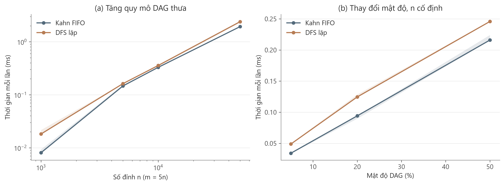
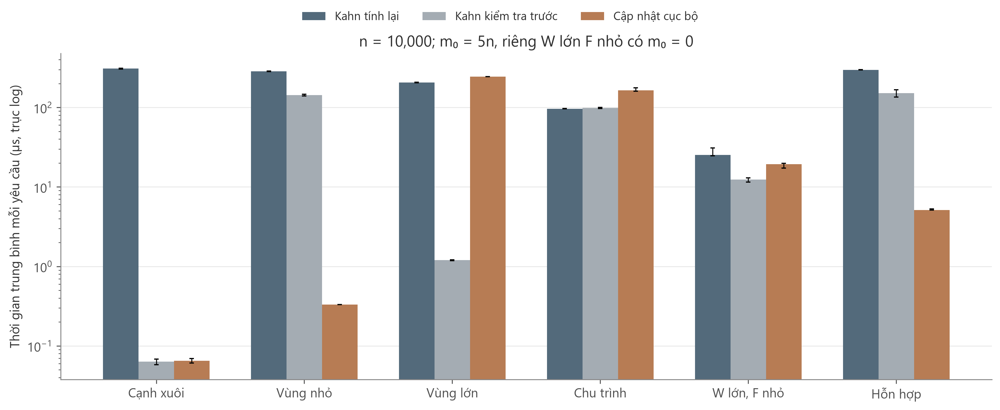

# Nội dung phần 7 cho ba slide trong 4 phút

Chữ xanh là nội dung chọn đưa lên slide; đoạn lời dẫn nằm trong ghi chú người trình bày. Bảng và hình đầy đủ ở [báo cáo](Phan7_BaoCao.md). Toàn bộ số được sinh từ cùng CSV của đợt chạy chính thức.

## Slide 1 Thiết kế và kiểm chứng trước khi đo

**Thời lượng 45 giây.** Dùng sơ đồ hai nhánh tĩnh/động, không trình bày cấu trúc repository.

- Topo tĩnh: Kahn FIFO và DFS lặp.
- Topo động: Kahn tính lại, Kahn kiểm tra trước và cập nhật cục bộ.
- Cùng đầu vào; 5 seed × 10 lượt đo, 3 lượt khởi động; kiểm tra thứ tự và chu trình trước khi đo.
- 280 workload; thời gian đo không gồm giao diện, sinh dữ liệu và kiểm chứng.

**Lời dẫn:** “Nhóm so sánh riêng topo tĩnh và cập nhật thứ tự. Ở bài toán động, nhóm thêm baseline Kahn kiểm tra vị trí trước khi tính lại để so sánh chặt chẽ hơn. Các phương pháp chạy cùng dữ liệu trên một máy; mỗi cấu hình có năm seed và mười lượt đo sau khởi động. Kết quả được kiểm tra trước khi đưa vào thống kê.”

## Slide 2 Chi phí topo tĩnh tăng theo quy mô và mật độ

**Thời lượng 45 giây.** Dùng Hình 7.1; giải thích trục trước khi đọc xu hướng.

- Kahn và DFS đều tăng thời gian khi n hoặc m tăng.
- m = 5n, n = 50.000: Kahn 1,933 ms; DFS 2,396 ms.
- Cùng O(n + m); chênh lệch thực tế phụ thuộc bản cài đặt và dữ liệu.

**Lời dẫn:** “Hình bên trái tăng số đỉnh với số cạnh bằng năm lần số đỉnh; hình bên phải giữ số đỉnh và tăng mật độ. Cả hai thuật toán đều tăng thời gian. Trong bản cài đặt này Kahn có trung vị thấp hơn trên các cấu hình minh họa, nhưng việc DFS xét ít cạnh hơn không tự bảo đảm nó nhanh hơn, vì còn có thao tác ngăn xếp và trạng thái. Đây là đối chiếu thực nghiệm, không phải chứng minh một thuật toán luôn thắng.”

## Slide 3 Cập nhật cục bộ có lợi khi vùng tác động nhỏ

**Thời lượng 2 phút 30 giây.** Dùng Hình 7.2 là hình chính. Có thể đặt ba số đếm ngắn dưới hình; không ép thêm toàn bộ Hình 7.3 vào cùng slide.

- Vùng nhỏ: tìm 7 đỉnh, ghi 8 vị trí; S = 859,18 so với Kahn tính lại.
- Vùng lớn: S = 0,84; chu trình: S = 0,58. Cục bộ có thể chậm hơn.
- W lớn, F nhỏ: tìm 1 đỉnh nhưng ghi 9.801 vị trí.
- Kahn kiểm tra trước cũng tránh tính lại ở cạnh xuôi; cần chọn theo workload.

Ghi nhỏ dưới hình: “n = 10.000; q = 200; m₀ = 50.000, riêng W lớn F nhỏ có m₀ = 0. Trục thời gian log. S là trung vị tỷ số theo cặp seed; S > 1 có lợi cho cục bộ.” Nguồn số liệu: thí nghiệm nhóm, repository này.

**Chia lời dẫn:**

- **90 giây cho thời gian:** “Với cạnh xuôi, cả cục bộ và Kahn kiểm tra trước đều bỏ được phép tính lại. Khi vùng sửa nhỏ, cục bộ có lợi rõ vì mỗi yêu cầu chỉ chạm rất ít đỉnh. Nhưng ở vùng lớn và chu trình, hệ số dưới một cho thấy cục bộ chậm hơn Kahn tính lại. Đặc biệt, trong workload vùng lớn, Kahn kiểm tra trước chỉ tính lại một lần rồi thứ tự mới khiến các yêu cầu sau trở thành cạnh xuôi. Vì vậy, cùng chuỗi cập nhật không có nghĩa là mọi phương pháp giữ cùng thứ tự hoặc cùng vùng tác động.”
- **45 giây cho nguyên nhân:** “Bộ đếm giúp giải thích kết quả: vùng nhỏ chỉ tìm bảy đỉnh và ghi tám vị trí; vùng lớn phải tìm sáu nghìn đỉnh và ghi sáu nghìn lẻ một vị trí. Ngay cả khi chỉ tìm một đỉnh, cửa sổ lớn vẫn làm phải ghi gần toàn bộ mảng thứ tự. Do đó, phân tích cần tính cả độ dài cửa sổ, không chỉ số đỉnh được tìm.”
- **15 giây chốt:** “Kết quả ủng hộ cập nhật cục bộ khi tác động nhỏ, đồng thời cho thấy nó không luôn nhanh hơn. Kết luận hiện giới hạn ở dữ liệu tổng hợp và bản cài đặt đã đo; từ đó nhóm trở lại ba câu hỏi đầu bài để tổng kết.”

## Những nội dung giữ trong report hoặc slide dự phòng

Bảng bộ nhớ, chứng minh, các lệnh chạy, toàn bộ ma trận dữ liệu, biểu đồ mật độ Hình 7.4 và các CSV không cần đọc trong 4 phút. Nếu được hỏi về tính công bằng, giải thích cùng G₀, π₀ và chuỗi yêu cầu, nhưng cho phép thứ tự sau cập nhật khác nhau. Nếu được hỏi về hệ số rất lớn ở cạnh xuôi, nhấn mạnh baseline Kahn kiểm tra trước có nhánh nhanh tương tự.
